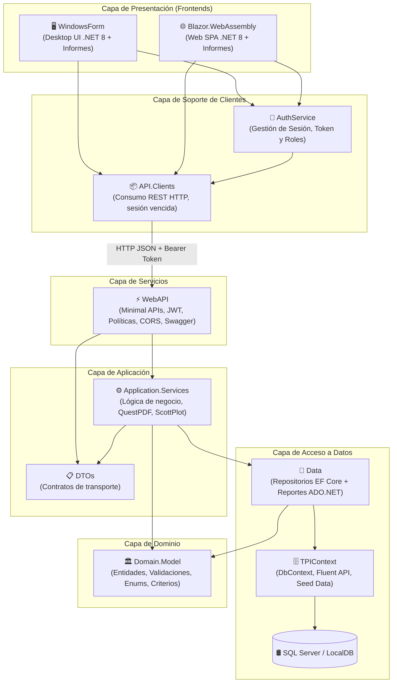
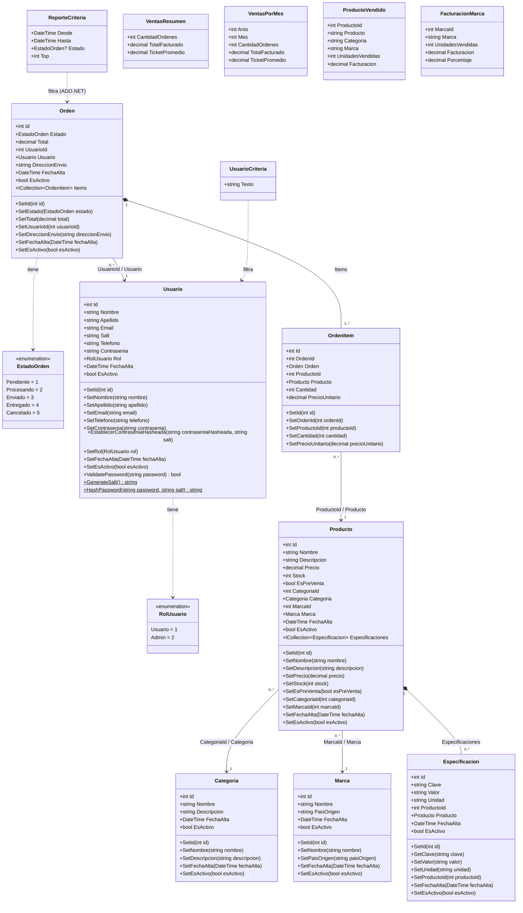

# 🛠️ Sistema de Gestión Hardware Store

Proyecto Integrador — Tecnologías de Desarrollo de Software IDE

## 👥 Integrantes

| Nombre | Legajo | Email |
|---|---|---|
| Gil Agustín | 50412 | agussv360@gmail.com |
| Fiorini Mauricio | 50475 | mauriciofiorini911@gmail.com |
| Herrera Nicolás | 51541 | herreranico2703@gmail.com |

---

## 📋 Descripción

El sistema consiste en una solución integral de software orientada a la gestión y comercialización de hardware de computadoras y componentes tecnológicos (CPUs, GPUs, RAM, periféricos, etc.). Permite la administración integral del catálogo de productos con sus especificaciones técnicas dinámicas, gestión de marcas, categorías, usuarios con control de roles y el procesamiento de órdenes de compra con detalle de ítems.

La solución está construida sobre **.NET 8** siguiendo una **arquitectura en capas (N-Capas)**, donde la lógica de negocio reside en un backend expuesto mediante **ASP.NET Core Minimal APIs** con autenticación y autorización basada en tokens **JWT**.

La API es consumida de manera unificada a través de una librería de clientes HTTP compartida (`API.Clients`) por dos aplicaciones frontend:
1. **Windows Forms (.NET 8)**: aplicación de escritorio para la administración y operación interna.
2. **Blazor WebAssembly (.NET 8)**: aplicación web SPA (Single Page Application) para la navegación, compras y gestión desde el navegador.

La capa de persistencia se implementa de forma híbrida para balancear productividad y rendimiento:
- **Entity Framework Core 9** sobre **Microsoft SQL Server** para las operaciones transaccionales (CRUD), utilizando el patrón Repository, mapeo relacional con Fluent API, bajas lógicas (`EsActivo`) y datos iniciales de prueba (`HasData`). La base se crea automáticamente con `EnsureCreated()`.
- **ADO.NET (`Microsoft.Data.SqlClient`)** para el módulo de reportes de ventas, con consultas SQL parametrizadas de agregación, agrupamiento y funciones de ventana.

Para los reportes, la capa de servicios utiliza:
- **QuestPDF** para generar el informe en formato PDF.
- **ScottPlot 5** para generar los gráficos de barras como imágenes PNG del lado del servidor. Esas mismas imágenes se insertan en el PDF y se muestran en Blazor y en Windows Forms.

---

## ⚙️ Funcionalidades Principales

- 🔐 **Autenticación y Seguridad**:
  - Autenticación mediante tokens **JWT (JSON Web Tokens)** con expiración configurable (`JwtSettings:ExpirationMinutes`).
  - Almacenamiento seguro de contraseñas con derivación de claves **PBKDF2** (`Rfc2898DeriveBytes`, SHA-256, 10.000 iteraciones) y `Salt` criptográfico de 32 bytes por usuario.
  - Autorización por políticas granulares por entidad y acción (`leer`, `agregar`, `actualizar`, `eliminar`): cada endpoint declara su política con `.RequireAuthorization("ProductosLeer")` y el token incluye los permisos (`permission`) según el rol.
  - Roles de usuario diferenciados: `Admin` (gestión integral) y `Usuario` (consulta y compras).
  - Auto-registro de nuevos clientes desde el login de Windows Forms (enlace **"Registrarse"** en `LoginForm`).
  - Detección de sesión vencida: un `DelegatingHandler` (`SesionExpiradaHandler`) intercepta las respuestas `401` y la aplicación vuelve a pedir el login.

- 🧑‍💼 **Gestión de Usuarios**:
  - Alta, baja lógica, modificación y consulta de usuarios (Windows Forms y Blazor).
  - Búsqueda por criterios (`UsuarioCriteria`: coincidencia por nombre, apellido y email).
  - Validación de unicidad de email y reglas de integridad en el dominio.

- 📦 **Catálogo de Productos y Hardware**:
  - Control de stock, precio, fecha de alta y estado de pre-venta (`EsPreVenta`).
  - Relación obligatoria con categoría y marca, y control de nombres y descripciones duplicados.
  - Bajas lógicas para preservar la integridad referencial en órdenes históricas.
  - Vistas diferenciadas en Blazor: gestión administrativa (CRUD, `Productos.razor`) y catálogo para clientes (`ProductosUser.razor`).

- ⚙️ **Especificaciones Técnicas Dinámicas**:
  - Sistema de atributos clave-valor por producto con unidad de medida opcional (ej. Cores: 6, Frecuencia: 3.5 GHz, TDP: 65 W, VRAM: 12 GB, Socket: AM4).
  - Gestión en **Windows Forms** (`ProductoEspecificaciones`, `EspecificacionDetalle`) y en **Blazor WebAssembly** (`EspecificacionesModal`: CRUD para el Admin y solo lectura para el Usuario).
  - Control de claves duplicadas por producto y consulta filtrada por producto.

- 🏷️ **Categorías y Marcas**:
  - Administración completa (CRUD) de familias de productos (CPU, RAM, GPU, Mouse, Auriculares) y marcas fabricantes (Nvidia, AMD, Logitech, Corsair, Sony) en Windows Forms y Blazor (`Categorias.razor`, `Marcas.razor`).
  - Control de unicidad de nombres para prevenir duplicados.

- 🧾 **Órdenes de Compra y Detalle de Ítems**:
  - Creación y seguimiento de órdenes vinculadas a usuarios clientes.
  - Detalle de ítems (`OrdenItem`) con cantidad, precio unitario al momento de la compra y cálculo automático de subtotales y total.
  - Validación y descuento de stock al confirmar la orden (los productos en pre-venta no requieren stock).
  - Ciclo de estados de la orden: `Pendiente`, `Procesando`, `Enviado`, `Entregado` y `Cancelado`.
  - Historial de compras personal para clientes (`MisOrdenes.razor`) y gestión administrativa global (`Ordenes.razor` y `OrdenLista`).

- 📊 **Módulo de Reportes de Ventas**:
  - Consultas analíticas con **ADO.NET** (`SqlConnection`, `SqlCommand`, `SqlDataReader`) con parámetros tipados y funciones de agregación (`COUNT`, `SUM`, `AVG`, `SUM(...) OVER()`).
  - **Resumen**: total facturado, cantidad de órdenes y ticket promedio, más ventas por mes, top de productos más vendidos y facturación por marca (monto y porcentaje).
  - **Filtros**: rango de fechas, estado de la orden (por defecto excluye las canceladas) y cantidad de productos del top.
  - **Exportación a PDF con QuestPDF**: informe en formato A4 con gráficos, tablas y numeración de páginas.
  - **Gráficos de barras con ScottPlot**: generados en el servidor como PNG y reutilizados en el PDF, en Blazor y en Windows Forms.
  - Disponible en ambos frontends: formulario `InformeVentas` en Windows Forms (pestañas con resumen, gráficos y tablas, más exportación a PDF) y página `/informes` en Blazor, con descarga del PDF.
  - Acceso restringido al rol `Admin` (permiso `reportes.leer`).

---

## 💻 Tecnologías Utilizadas

- **Lenguaje**: C# 12
- **Plataforma / Runtime**: .NET 8.0
- **Backend**: ASP.NET Core Minimal APIs
- **ORM y persistencia transaccional**: Entity Framework Core 9.0 (SQL Server Provider, Fluent API, `EnsureCreated`)
- **Acceso a datos para reportes**: ADO.NET (`Microsoft.Data.SqlClient`)
- **Generación de PDF**: QuestPDF (licencia Community)
- **Gráficos**: ScottPlot 5 (imágenes PNG generadas en el servidor)
- **Base de Datos**: Microsoft SQL Server / LocalDB
- **Seguridad**: JWT Bearer (`Microsoft.AspNetCore.Authentication.JwtBearer`), hashing PBKDF2 SHA-256 con Salt
- **Documentación de API**: Swagger / OpenAPI (Swashbuckle)
- **Configuración de clientes**: `appsettings.json` (URL de la API), leído con `Microsoft.Extensions.Configuration` en Windows Forms
- **Frontends**:
  - **Escritorio**: Windows Forms (.NET 8)
  - **Web**: Blazor WebAssembly (.NET 8 SPA)
- **Comunicación**: `HttpClient` compartido con `System.Net.Http.Json`

---

## 🏗️ Arquitectura del Sistema

El proyecto se encuentra modularizado en 9 proyectos dentro de la solución:



### Descripción de cada Proyecto:

1. **`Domain.Model`**: entidades del dominio con encapsulamiento (setters privados), métodos `Set...` con validaciones, lógica de hasheo y verificación de contraseñas, y modelos de criterios y de resultados de reportes (`UsuarioCriteria`, `ReporteCriteria`, `VentasResumen`, etc.). No tiene dependencias externas.
2. **`DTOs`**: clases utilizadas para la comunicación entre capas y la serialización JSON en la API (incluyendo DTOs de órdenes, especificaciones y reportes), evitando exponer directamente las entidades del dominio.
3. **`Data`**: persistencia híbrida: EF Core (`TPIContext`) para operaciones transaccionales mediante el patrón Repository, y **ADO.NET** (`ReporteRepository`) con `SqlConnection`, `SqlCommand` y `SqlDataReader` para las consultas de los reportes.
4. **`Application.Services`**: servicios que coordinan repositorios y DTOs, validan reglas de negocio y generan los reportes: gráficos con **ScottPlot** (`GraficosReporte`) y PDF con **QuestPDF** (`InformeVentasPDF`).
5. **`WebAPI`**: aplicación ASP.NET Core que expone los endpoints HTTP organizados por entidad y de reportes (`ReporteEndpoints`: datos JSON, gráficos y PDF), autentica mediante JWT y protege cada recurso según los permisos del usuario.
6. **`API.Clients`**: librería compartida de clientes HTTP (`*ApiClient`, incluyendo `ReporteApiClient`) que encapsula las llamadas a la WebAPI, envía el token en la cabecera `Authorization: Bearer <token>`, toma la URL de la API desde la configuración de cada aplicación y detecta la sesión vencida (`SesionExpiradaHandler`).
7. **`AuthService`**: manejo centralizado del estado de la sesión en el cliente (token, datos del usuario autenticado, eventos de login/logout y comprobación de rol de administrador).
8. **`WindowsForm`**: aplicación de escritorio MDI con login, auto-registro, listados con `DataGridView`, formularios de alta/edición de entidades y el informe de ventas (`InformeVentas`) con pestañas de resumen, gráficos y tablas, y exportación a PDF.
9. **`Blazor.WebAssembly`**: aplicación web SPA basada en componentes Razor para administración, catálogo de clientes, compras (`MisOrdenes`) y el informe de ventas (`/informes`) con gráficos y descarga de PDF.

---

## 🗂️ Diagrama de Clases

A continuación se presenta el diagrama de clases del modelo de dominio (`Domain.Model`) modelado con Mermaid:



> [!NOTE]
> Para consultar el diagrama de clases conceptual previo en formato gráfico, revisar el archivo adjunto [docs/DDC.png](docs/DDC.png).

---

## 📁 Estructura del Repositorio

```
IDE-TPI/
├── docs/
│   ├── conversaciones-ia/      # Bitácora documentada de sesiones de asistencia con IA
│   └── DDC.png                 # Diagrama de clases de diseño conceptual original
├── TPI/
│   ├── API.Clients/            # Clientes HTTP para consumo de la API REST
│   │   ├── ApiClient.cs        # HttpClient compartido: URL configurable y token JWT
│   │   ├── SesionExpiradaHandler.cs # Detecta respuestas 401 (sesión vencida)
│   │   ├── CategoriaApiClient.cs
│   │   ├── EspecificacionApiClient.cs
│   │   ├── MarcaApiClient.cs
│   │   ├── OrdenApiClient.cs
│   │   ├── ProductoApiClient.cs
│   │   ├── ReporteApiClient.cs # Informe, gráficos y descarga de PDF
│   │   └── UsuarioApiClient.cs
│   ├── Application.Services/   # Servicios de negocio y generación de reportes
│   │   ├── Reportes/
│   │   │   ├── GraficosReporte.cs     # Gráficos de barras con ScottPlot (PNG)
│   │   │   └── InformeVentasPDF.cs    # Generación del informe PDF con QuestPDF
│   │   ├── CategoriaService.cs / ICategoriaService.cs
│   │   ├── EspecificacionService.cs / IEspecificacionService.cs
│   │   ├── MarcaService.cs / IMarcaService.cs
│   │   ├── OrdenService.cs / IOrdenService.cs
│   │   ├── ProductoService.cs / IProductoService.cs
│   │   ├── ReporteService.cs / IReporteService.cs
│   │   └── UsuarioService.cs / IUsuarioService.cs
│   ├── AuthService/            # Estado de sesión y autenticación cliente
│   │   └── AuthService.cs
│   ├── Blazor.WebAssembly/     # Cliente web SPA en Blazor WebAssembly (.NET 8)
│   │   ├── Components/         # Modales de Categorías, Marcas, Productos, Especificaciones, Órdenes y Usuarios
│   │   │   ├── CategoriaModal.razor
│   │   │   ├── EspecificacionesModal.razor
│   │   │   ├── MarcaModal.razor
│   │   │   ├── OrdenModal.razor
│   │   │   ├── ProductoModal.razor
│   │   │   └── UsuarioModal.razor
│   │   ├── Layout/             # MainLayout, NavMenu con control de roles
│   │   ├── Pages/
│   │   │   ├── Categorias.razor
│   │   │   ├── Home.razor
│   │   │   ├── Informes.razor
│   │   │   ├── Login.razor
│   │   │   ├── Marcas.razor
│   │   │   ├── MisOrdenes.razor
│   │   │   ├── Ordenes.razor
│   │   │   ├── Productos.razor
│   │   │   ├── ProductosUser.razor
│   │   │   └── Usuarios.razor
│   │   ├── wwwroot/            # appsettings.json (URL de la API), estilos, bg.png, script de descarga de PDF
│   │   └── Program.cs
│   ├── Data/                   # DbContext de EF Core, repositorios y reportes en ADO.NET
│   │   ├── CategoriaRepository.cs / ICategoriaRepository.cs
│   │   ├── EspecificacionRepository.cs / IEspecificacionRepository.cs
│   │   ├── MarcaRepository.cs / IMarcaRepository.cs
│   │   ├── OrdenRepository.cs / IOrdenRepository.cs
│   │   ├── ProductoRepository.cs / IProductoRepository.cs
│   │   ├── ReporteRepository.cs / IReporteRepository.cs # Consultas ADO.NET de reportes
│   │   ├── UsuarioRepository.cs / IUsuarioRepository.cs
│   │   └── TPIContext.cs
│   ├── Domain.Model/           # Entidades de dominio, validaciones, criterios y enums
│   │   ├── Categoria.cs
│   │   ├── Especificacion.cs
│   │   ├── EstadoOrden.cs
│   │   ├── FacturacionMarca.cs
│   │   ├── Marca.cs
│   │   ├── Orden.cs
│   │   ├── OrdenItem.cs
│   │   ├── Producto.cs
│   │   ├── ProductoVendido.cs
│   │   ├── ReporteCriteria.cs
│   │   ├── RolUsuario.cs
│   │   ├── Usuario.cs
│   │   ├── UsuarioCriteria.cs
│   │   ├── VentasPorMes.cs
│   │   └── VentasResumen.cs
│   ├── DTOs/                   # Data Transfer Objects
│   │   ├── AuthResponseDTO.cs
│   │   ├── CategoriaDTO.cs
│   │   ├── EspecificacionDTO.cs
│   │   ├── FacturacionMarcaDTO.cs
│   │   ├── GraficosInformeDTO.cs
│   │   ├── InformesVentasDTO.cs
│   │   ├── LoginDTO.cs
│   │   ├── MarcaDTO.cs
│   │   ├── OrdenDTO.cs
│   │   ├── OrdenItemDTO.cs
│   │   ├── ProductoDTO.cs
│   │   ├── ProductoVendidoDTO.cs
│   │   ├── UsuarioCriteriaDTO.cs
│   │   ├── UsuarioDTO.cs
│   │   ├── VentasPorMesDTO.cs
│   │   └── VentasResumenDTO.cs
│   ├── WebAPI/                 # Backend REST (Minimal APIs, JWT, Swagger)
│   │   ├── CategoriaEndpoints.cs
│   │   ├── EspecificacionEndpoints.cs
│   │   ├── MarcaEndpoints.cs
│   │   ├── OrdenEndpoints.cs
│   │   ├── ProductoEndpoints.cs
│   │   ├── ReporteEndpoints.cs # Informe (JSON), gráficos y PDF
│   │   ├── UsuarioEndpoints.cs
│   │   ├── JwtService.cs
│   │   ├── Program.cs
│   │   └── appsettings.json
│   └── WindowsForm/            # Cliente de escritorio Windows Forms (.NET 8)
│       ├── Program.cs          # Configuración inicial (URL de la API y cultura es-AR)
│       ├── appsettings.json    # URL de la API
│       ├── LoginForm.cs        # Login con opción de auto-registro
│       ├── Home.cs             # Formulario MDI principal con menú según rol
│       ├── UsuarioLista.cs / UsuarioDetalle.cs
│       ├── CategoriaLista.cs / CategoriaDetalle.cs
│       ├── MarcaLista.cs / MarcaDetalle.cs
│       ├── ProductoLista.cs / ProductoDetalle.cs / ProductoEspecificaciones.cs
│       ├── EspecificacionDetalle.cs
│       ├── OrdenLista.cs / OrdenDetalle.cs
│       └── InformeVentas.cs    # Informe de ventas: resumen, gráficos, tablas y exportación a PDF
└── README.md
```
---

### 💡 Análisis y Cobertura de Reportes

Evaluando el modelo de negocio del e-commerce, se detalla el estado de implementación de los reportes:

| Prioridad | Reporte | Descripción y Valor para el Negocio | Implementación Técnica | Estado |
|:---:|---|---|---|:---:|
| 🥇 **1** | **Ventas por Período y Estado de Órdenes** | Reporte principal de facturación. Filtra por rango de fechas (desde/hasta) y estado (`Entregado`, `Pendiente`, etc.). Muestra total facturado, ticket promedio, cantidad de órdenes y evolución mensual. | Consultas ADO.NET sobre `Ordenes` con filtro `FechaAlta >= @Desde AND FechaAlta < DATEADD(DAY, 1, @Hasta)` y por estado (por defecto excluye canceladas y eliminadas), `GROUP BY YEAR/MONTH(FechaAlta)` y agregaciones `COUNT()`, `SUM(Total)` y `AVG(Total)`. | ✅ **Implementado** (WinForms, Blazor, PDF y gráficos) |
| 🥈 **2** | **Top Productos Más Vendidos y Facturación por Marca** | Análisis comercial de rotación de stock e ingresos generados por cada fabricante y componente de hardware. | Consultas ADO.NET con `JOIN` entre `OrdenItems`, `Ordenes`, `Productos`, `Categorias` y `Marcas`, agrupando con `SUM(Cantidad)` y `SUM(Cantidad * PrecioUnitario)` (precio al momento de la venta), `TOP (@Top)` y porcentaje sobre el total con `SUM(...) OVER()`. | ✅ **Implementado** (WinForms, Blazor, PDF y gráficos) |
| 🥉 **3** | **Comprobante / Factura de Orden de Compra** | Generación de comprobante imprimible de una orden específica con datos del cliente, dirección, detalle de ítems y total final. | Consulta parametrizada por `@OrdenId` combinando cabecera de orden con líneas de detalle. | ⏳ *Sugerido para próxima etapa* |
| 4 | **Stock Crítico y Alerta de Reposición** | Detección de productos cuyo stock es inferior al umbral mínimo o en condición de pre-venta. | Filtro condicional sobre productos activos con ordenamiento por criticidad de inventario. | ⏳ *Sugerido para próxima etapa* |
| 5 | **Ranking de Clientes con Mayor Facturación** | Identificación de los clientes más recurrentes y con mayor volumen histórico de compra. | `JOIN` entre `Usuarios` y `Ordenes` agrupado por cliente. | ⏳ *Sugerido para próxima etapa* |

> [!TIP]
> **Alcance de la entrega:** se implementaron los dos reportes de mayor impacto (**Reporte 1: Ventas por Período** y **Reporte 2: Top Productos y Facturación por Marca**), combinando consultas SQL en **ADO.NET**, gráficos generados con **ScottPlot**, exportación a **PDF (QuestPDF)** y visualización en **ambos clientes** (Windows Forms y Blazor WebAssembly).

---

## 🚀 Guía de Instalación y Ejecución

### Prerrequisitos

- [.NET 8.0 SDK](https://dotnet.microsoft.com/download/dotnet/8.0) instalado.
- [Microsoft SQL Server](https://www.microsoft.com/sql-server/) o **SQL Server Express LocalDB** (instalado habitualmente con Visual Studio).

### 1. Configuración de Base de Datos

En [TPI/WebAPI/appsettings.json](TPI/WebAPI/appsettings.json), verificar o ajustar la cadena de conexión:

```json
"ConnectionStrings": {
    "DefaultConnection": "Server=(localdb)\\MSSQLLocalDB;Database=TPI;Trusted_Connection=true;MultipleActiveResultSets=true;TrustServerCertificate=true"
}
```

> [!TIP]
> Al iniciar la `WebAPI`, `context.Database.EnsureCreated()` creará automáticamente la base de datos `TPI` y cargará los datos de prueba iniciales (categorías, marcas, productos, especificaciones y usuarios).

> [!WARNING]
> `EnsureCreated()` solo crea la base si no existe: **no actualiza tablas existentes**. Si la base se creó con una versión anterior del modelo, hay que eliminarla para que se vuelva a crear (o aplicar el cambio a mano).

### 2. Configuración de la URL de la API en los clientes

Ambos frontends leen la dirección de la API desde su propio `appsettings.json` (por defecto `http://localhost:5183/`):

- Windows Forms: [TPI/WindowsForm/appsettings.json](TPI/WindowsForm/appsettings.json)
- Blazor: [TPI/Blazor.WebAssembly/wwwroot/appsettings.json](TPI/Blazor.WebAssembly/wwwroot/appsettings.json)

```json
{
  "ApiBaseUrl": "http://localhost:5183/"
}
```

### 3. Ejecutar la WebAPI

Desde la raíz del repositorio:

```bash
dotnet run --project TPI/WebAPI
```

- La API inicia por defecto en `http://localhost:5183/`.
- Documentación interactiva Swagger: `http://localhost:5183/swagger`.

### 4. Ejecutar el Cliente Windows Forms

En una nueva terminal:

```bash
dotnet run --project TPI/WindowsForm
```

### 5. Ejecutar el Cliente Blazor WebAssembly

En una nueva terminal:

```bash
dotnet run --project TPI/Blazor.WebAssembly
```

- La aplicación web inicia por defecto en `http://localhost:5011/`.

---

## 🔑 Usuarios de Prueba (Seed Data)

La base de datos se inicializa con los siguientes usuarios para pruebas:

| Rol | Email | Contraseña | Permisos |
|---|---|---|---|
| **Administrador** | `juan@gmail.com` | `usuario123` | Acceso completo (CRUD de usuarios, productos, marcas, categorías, especificaciones y órdenes, e informes) |
| **Usuario** | `agus@gmail.com` | `usuario123` | Navegación del catálogo, consulta de especificaciones y compras |

---

## 📄 Licencia

Proyecto académico desarrollado con fines educativos para la materia **Tecnologías de Desarrollo de Software IDE**. 🎓
