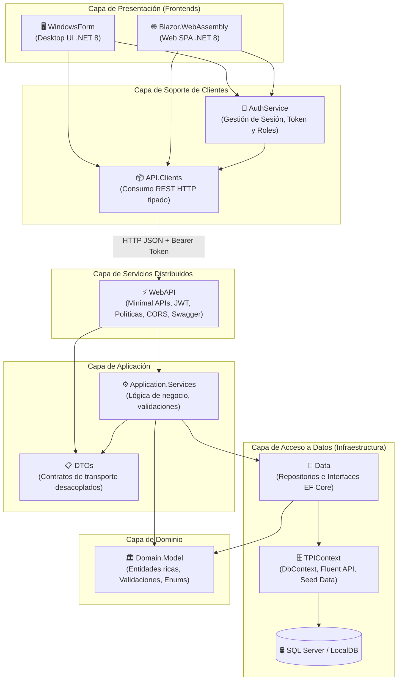
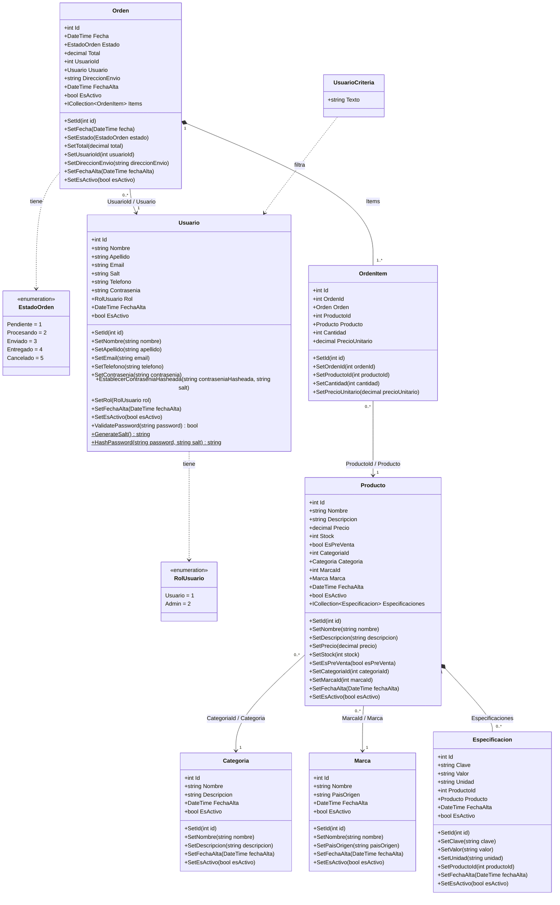

# 🛠️ Sistema de Gestión Hardware Store

Proyecto Integrador — Tecnologías de Desarrollo de Software IDE

## 👥 Integrantes

| Nombre | Legajo | Email |
|---|---|---|
| Gil Agustín | 50412 | agussv360@gmail.com |
| Fiorini Mauricio | 50475 | mauriciofiorini911@gmail.com |
| Herrera Nicolás | 51541 | herreranico2703@gmail.com |

---

## 📋 Descripción

El sistema consiste en una solución integral de software orientada a la gestión y comercialización de hardware de computadoras y componentes tecnológicos (CPUs, GPUs, RAM, periféricos, etc.). Permite la administración integral del catálogo de productos con sus especificaciones técnicas dinámicas, gestión de marcas, categorías, usuarios con control de roles y el procesamiento de órdenes de compra con detalle de ítems.

La solución está construida sobre **.NET 8** siguiendo una **arquitectura en capas desacoplada (Clean Architecture / N-Capas)**, donde el núcleo del negocio reside en un backend distribuido expuesto mediante **ASP.NET Core Minimal APIs** con autenticación y autorización basada en tokens **JWT**. 

La API es consumida de manera unificada a través de una librería de clientes HTTP compartida (`API.Clients`) por dos aplicaciones frontend cliente:
1. **Windows Forms (.NET 8)**: Aplicación de escritorio diseñada para la administración y operación rápida en el punto de venta o gestión interna.
2. **Blazor WebAssembly (.NET 8)**: Aplicación web interactiva tipo SPA (Single Page Application) que permite la navegación y gestión remota desde el navegador.

La capa de persistencia se implementa con **Entity Framework Core 9** sobre **Microsoft SQL Server**, utilizando el patrón Repository, mapeo relacional con Fluent API, soporte para bajas lógicas (`EsActivo`), y sembrado inicial de datos (`Seed Data`).

---

## ⚙️ Funcionalidades Principales

- 🔐 **Autenticación y Seguridad**:
  - Autenticación mediante tokens **JWT (JSON Web Tokens)** con expiración configurable.
  - Almacenamiento seguro de contraseñas con derivación de claves **PBKDF2** (`Rfc2898DeriveBytes` con SHA-256) y generación de `Salt` criptográfico de 32 bytes por usuario.
  - Autorización basada en políticas granulares (`[Authorize(Policy = "...")]`) tanto por entidad como por acción (`leer`, `agregar`, `actualizar`, `eliminar`).
  - Roles de usuario diferenciados: `Admin` (gestión integral) y `Usuario` (consulta y compras).

- 🧑‍💼 **Gestión de Usuarios**:
  - Alta, baja lógica, modificación y consulta de usuarios.
  - Búsqueda dinámica y filtrado por criterios (`UsuarioCriteria`: coincidencia por nombre, apellido y email).
  - Validación de unicidad de email y reglas de integridad en el dominio.

- 📦 **Catálogo de Productos y Hardware**:
  - Control de stock, precios unitarios, fecha de alta y estado de pre-venta (`EsPreVenta`).
  - Relación obligatoria con categoría y marca.
  - Bajas lógicas para preservar integridad referencial en órdenes históricas.

- ⚙️ **Especificaciones Técnicas Dinámicas**:
  - Sistema de atributos clave-valor por producto con soporte para unidades de medida opcionales (ej. Cores: 6, Frecuencia: 3.5 GHz, TDP: 65 W, VRAM: 12 GB, Socket: AM4).
  - Eliminación en cascada y consulta filtrada por producto.

- 🏷️ **Categorías y Marcas**:
  - Administración de familias de productos (CPU, RAM, GPU, Mouse, Auriculares) y marcas fabricantes (Nvidia, AMD, Logitech, Corsair, Sony).
  - Control de unicidad de nombres para prevenir duplicados.

- 🧾 **Órdenes de Compra y Detalle de Ítems**:
  - Creación y seguimiento de órdenes vinculadas a usuarios clientes.
  - Detalle de ítems (`OrdenItem`) con cantidad, precio unitario y cálculo automático de totales.
  - Ciclo de estados de la orden mediante enumerador: `Pendiente`, `Procesando`, `Enviado`, `Entregado` y `Cancelado`.

---

## 💻 Tecnologías Utilizadas

- **Lenguaje**: C# 12
- **Plataforma / Runtime**: .NET 8.0
- **Backend**: ASP.NET Core Minimal APIs
- **ORM & Persistencia**: Entity Framework Core 9.0 (SQL Server Provider, Migrations, Fluent API)
- **Base de Datos**: Microsoft SQL Server / LocalDB
- **Seguridad**: JWT Bearer (`Microsoft.AspNetCore.Authentication.JwtBearer`), Hashing PBKDF2 SHA-256 con Salt
- **Documentación de API**: Swagger / OpenAPI (Swashbuckle)
- **Frontends**:
  - **Escritorio**: Windows Forms (.NET 8)
  - **Web**: Blazor WebAssembly (.NET 8 SPA)
- **Comunicación**: `HttpClient` fuertemente tipado con `System.Net.Http.Json`

---

## 🏗️ Arquitectura del Sistema

El proyecto se encuentra modularizado en 9 proyectos independientes dentro de la solución:



### Descripción de cada Proyecto:

1. **`Domain.Model`**: Contiene las entidades puras del dominio de negocio con encapsulamiento estricto, métodos mutadores con validaciones y lógica de hasheo/verificación criptográfica. No tiene dependencias externas.
2. **`DTOs`**: Clases POCO utilizadas para la comunicación entre capas y la serialización JSON en la API, protegiendo las entidades del dominio de exposición indebida.
3. **`Data`**: Implementación de la persistencia con EF Core (`TPIContext`), definición de repositorios (`*Repository`), interfaces (`I*Repository`) y configuración de entidades mediante Fluent API.
4. **`Application.Services`**: Servicios de orquestación de negocio que coordinan la interacción entre los repositorios y los DTOs, validando reglas antes de persistir o retornar datos.
5. **`WebAPI`**: Aplicación ASP.NET Core que expone los endpoints HTTP organizados por entidad, autentica mediante JWT y protege cada recurso según los permisos del usuario.
6. **`API.Clients`**: Librería compartida de clientes HTTP (`*ApiClient`) que encapsula las llamadas a la WebAPI y la gestión del token en la cabecera `Authorization: Bearer <token>`.
7. **`AuthService`**: Manejo centralizado del estado de la sesión activa en cliente (Token, datos del usuario autenticado, eventos de login/logout y comprobación de rol de administrador).
8. **`WindowsForm`**: Aplicación desktop con formularios para login, listados con DataGridView, filtrado y modales de edición/alta de todas las entidades.
9. **`Blazor.WebAssembly`**: Aplicación web SPA basada en componentes Razor para visualización y administración en navegadores web modernos.

---

## 🗂️ Diagrama de Clases

A continuación se presenta el diagrama de clases del modelo de dominio (`Domain.Model`) modelado con Mermaid:



> [!NOTE]
> Para consultar el diagrama de clases conceptual previo en formato gráfico, revisar el archivo adjunto [docs/DDC.png](docs/DDC.png).

---

## 📁 Estructura del Repositorio

```
IDE-TPI/
├── docs/
│   ├── conversaciones-ia/
│   └── DDC.png
├── TPI/
│   ├── API.Clients/            # Clientes HTTP tipados para consumo de la API REST
│   │   ├── ApiClient.cs
│   │   ├── CategoriaApiClient.cs
│   │   ├── EspecificacionApiClient.cs
│   │   ├── MarcaApiClient.cs
│   │   ├── OrdenApiClient.cs
│   │   ├── ProductoApiClient.cs
│   │   └── UsuarioApiClient.cs
│   ├── Application.Services/   # Servicios de negocio e interfaces
│   │   ├── CategoriaService.cs / ICategoriaService.cs
│   │   ├── EspecificacionService.cs / IEspecificacionService.cs
│   │   ├── MarcaService.cs / IMarcaService.cs
│   │   ├── OrdenService.cs / IOrdenService.cs
│   │   ├── ProductoService.cs / IProductoService.cs
│   │   └── UsuarioService.cs / IUsuarioService.cs
│   ├── AuthService/            # Estado de sesión y autenticación cliente
│   │   └── AuthService.cs
│   ├── Blazor.WebAssembly/     # Cliente web SPA en Blazor WebAssembly (.NET 8)
│   │   ├── Components/         # Modales de Categorías y Usuarios
│   │   ├── Layout/             # MainLayout, NavMenu
│   │   ├── Pages/              # Login, Home, Categorías, Usuarios
│   │   └── Program.cs
│   ├── Data/                   # DbContext de EF Core, repositorios y persistencia
│   │   ├── CategoriaRepository.cs / ICategoriaRepository.cs
│   │   ├── EspecificacionRepository.cs / IEspecificacionRepository.cs
│   │   ├── MarcaRepository.cs / IMarcaRepository.cs
│   │   ├── OrdenRepository.cs / IOrdenRepository.cs
│   │   ├── ProductoRepository.cs / IProductoRepository.cs
│   │   ├── UsuarioRepository.cs / IUsuarioRepository.cs
│   │   └── TPIContext.cs
│   ├── Domain.Model/           # Entidades de dominio, validaciones y enums
│   │   ├── Categoria.cs
│   │   ├── Especificacion.cs
│   │   ├── EstadoOrden.cs
│   │   ├── Marca.cs
│   │   ├── Orden.cs
│   │   ├── OrdenItem.cs
│   │   ├── Producto.cs
│   │   ├── RolUsuario.cs
│   │   ├── Usuario.cs
│   │   └── UsuarioCriteria.cs
│   ├── DTOs/                   # Data Transfer Objects
│   │   ├── AuthResponseDTO.cs
│   │   ├── CategoriaDTO.cs
│   │   ├── EspecificacionDTO.cs
│   │   ├── LoginDTO.cs
│   │   ├── MarcaDTO.cs
│   │   ├── OrdenDTO.cs
│   │   ├── OrdenItemDTO.cs
│   │   ├── ProductoDTO.cs
│   │   ├── UsuarioCriteriaDTO.cs
│   │   └── UsuarioDTO.cs
│   ├── WebAPI/                 # Backend REST (Minimal APIs, JWT, Swagger)
│   │   ├── CategoriaEndpoints.cs
│   │   ├── EspecificacionEndpoints.cs
│   │   ├── MarcaEndpoints.cs
│   │   ├── OrdenEndpoints.cs
│   │   ├── ProductoEndpoints.cs
│   │   ├── UsuarioEndpoints.cs
│   │   ├── JwtService.cs
│   │   ├── Program.cs
│   │   └── appsettings.json
│   └── WindowsForm/            # Cliente de escritorio Windows Forms (.NET 8)
│       ├── LoginForm.cs
│       ├── Home.cs
│       ├── UsuarioLista.cs / UsuarioDetalle.cs
│       ├── CategoriaLista.cs / CategoriaDetalle.cs
│       ├── MarcaLista.cs / MarcaDetalle.cs
│       ├── ProductoLista.cs / ProductoDetalle.cs / ProductoEspecificaciones.cs
│       └── OrdenLista.cs / OrdenDetalle.cs
└── README.md
```

---

## 🚀 Guía de Instalación y Ejecución

### Prerrequisitos

- [.NET 8.0 SDK](https://dotnet.microsoft.com/download/dotnet/8.0) instalado.
- [Microsoft SQL Server](https://www.microsoft.com/sql-server/) o **SQL Server Express LocalDB** (instalado habitualmente con Visual Studio).

### 1. Configuración de Base de Datos

En [TPI/WebAPI/appsettings.json](TPI/WebAPI/appsettings.json), verificar o ajustar la cadena de conexión:

```json
"ConnectionStrings": {
    "DefaultConnection": "Server=(localdb)\\MSSQLLocalDB;Database=TPI;Trusted_Connection=true;MultipleActiveResultSets=true;TrustServerCertificate=true"
}
```

> [!TIP]
> Al iniciar la `WebAPI`, `context.Database.EnsureCreated()` creará automáticamente la base de datos `TPI` y cargará los datos de prueba iniciales (seed de categorías, marcas, productos, especificaciones y usuarios).

### 2. Ejecutar la WebAPI

Abrir una terminal en el directorio raíz o en `TPI/WebAPI` y ejecutar:

```bash
dotnet run --project TPI/WebAPI
```

- La API iniciará por defecto en `http://localhost:5183/`.
- Acceso a la documentación interactiva Swagger: `http://localhost:5183/swagger`.

### 3. Ejecutar el Cliente Windows Forms

En una nueva terminal:

```bash
dotnet run --project TPI/WindowsForm
```

### 4. Ejecutar el Cliente Blazor WebAssembly

En una nueva terminal:

```bash
dotnet run --project TPI/Blazor.WebAssembly
```

---

## 🔑 Usuarios de Prueba (Seed Data)

La base de datos se inicializa con los siguientes usuarios para pruebas:

| Rol | Email | Contraseña | Permisos |
|---|---|---|---|
| **Administrador** | `juan@gmail.com` | `usuario123` | Acceso completo (CRUD de usuarios, productos, marcas, categorías, especificaciones y órdenes) |
| **Usuario** | `agus@gmail.com` | `usuario123` | Navegación, consulta y compras |

---

## 📄 Licencia

Proyecto académico desarrollado con fines educativos para la materia **Tecnologías de Desarrollo de Software IDE**. 🎓
